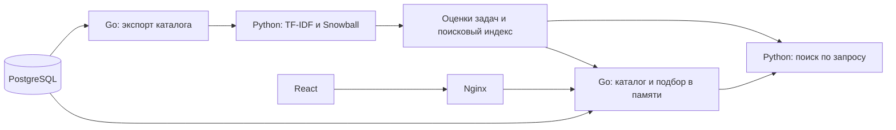

# Альфа-Курс

Подбор образовательных материалов под задачу предпринимателя. Пользователь описывает задачу своими словами или выбирает тему и при желании уточняет профиль; приложение возвращает до трёх материалов с объяснениями и ссылками. Анкету можно пропустить.

Проект использует исходный каталог кейса Hack&Change 2026: статьи, курсы, документы, термины, калькуляторы, подкасты и вебинары. Уроки входят в программы курсов.

## Запуск

Нужны Git, работающий Docker и Docker Compose v2. Go, Python и Node.js на компьютере не требуются.

```bash
git clone https://github.com/horizoonn/alfa-course-recsys.git
cd alfa-course-recsys
cp .env.example .env
```

1. Положите исходный backup в `data/alfa_course_hackathon.backup`. Файл нужно получить из материалов кейса отдельно; его нет в Git.
2. Проверьте `.env`. Если меняете пароль БД, обновите его в `POSTGRES_PASSWORD`, `DATABASE_URL` и `DATABASE_URL_DOCKER`. На Linux укажите свои `id -u` и `id -g` в `LOCAL_UID` и `LOCAL_GID`.
3. Из корня проекта выполните:

```bash
docker compose up -d --wait
```

При настройках из `.env.example`:

| Адрес | Назначение |
|---|---|
| http://localhost:5173 | Интерфейс |
| http://localhost:8080/api/health | Готовность API |
| `localhost:5434` | PostgreSQL для локальных инструментов |

Compose восстанавливает пустую БД, экспортирует каталог, рассчитывает TF-IDF, запускает внутренний Python-поиск и приложение. Заполненная БД сохраняется; подходящие индексы и файл текстовых оценок переиспользуются. В обычном режиме модель E5 не скачивается. При первом запуске потребуется время на скачивание образов, сборку и восстановление.

```bash
docker compose ps -a
docker compose logs -f app frontend
```

Если запуск остановился на подготовке данных:

```bash
docker compose logs db-restore catalog-export text-prepare
```

Остановка с сохранением базы:

```bash
docker compose down
```

## Что проверить в интерфейсе

| Действие | Ожидаемый результат |
|---|---|
| Нажать «Пропустить анкету» или выбрать P07 | Стартовая подборка; она работает и без локальной ручной разметки |
| Написать «Продажи есть, но денег постоянно не хватает» | Материалы о денежных потоках и кассовых разрывах |
| Написать «Помогите пожалуйста» | Просьба уточнить задачу |
| Выбрать P02 | Материалы для привлечения клиентов |
| Сравнить P03 и P04 | Различаются предпочтения: инструмент и подробное обучение |
| Указать только формат помощи | Сначала материалы с подтверждённым совпадением формата |
| Указать только стадию или опыт | Общая подборка с сообщением о недостатке подтверждённых совпадений |
| Выбрать H01–H03 в блоке истории | Реальная история из исходной БД: завершения, прогресс и оценки; это демонстрационные сценарии, а не ваш аккаунт |
| Выбрать P10 | Синтетическая история, если подключена локальная разметка; иначе `HISTORY_UNAVAILABLE` |

Различие выдач не доказывает, что одна полезнее другой. Для оценки качества нужен общий набор профилей и независимые оценки материалов.

## Как работает приложение



Python готовит оценки для восьми задач при запуске. Go загружает каталог одной read-only транзакцией, проверяет файл оценок. После загрузки каталога и исходной истории пул PostgreSQL закрывается. Каталог, оценки и H-сценарии находятся в памяти Go. Для свободного текста Go обращается к внутреннему Python-поиску; каталог при этом не пересылается.

При выборе задачи движок сочетает текстовое соответствие, проверенные правила и доступные признаки профиля. Пустая анкета использует ручную стартовую подборку с автоматическим дополнением. Если ручной подборки нет, выбираются бесплатные материалы со ссылками по запуску бизнеса, финансам и привлечению клиентов. Это общая подборка, а не предположение об интересах пользователя.

## API

Контракт: [api/openapi.yaml](api/openapi.yaml).

| Метод | Результат |
|---|---|
| `GET /api/health` | `200`, если каталог и оценки загружены |
| `GET /api/meta` | Варианты задач, стадий, сфер, опыта и формата |
| `GET /api/demo-profiles` | Профили P01–P10 |
| `GET /api/history-profiles` | Обезличенные сценарии H01–H03 из реальной истории |
| `POST /api/deepening` | До двух материалов для углубления темы конкретной карточки |
| `POST /api/recommendations` | До трёх карточек, режим подбора и ограничения |

Стартовая подборка:

```bash
curl http://localhost:8080/api/recommendations \
  -H 'Content-Type: application/json' -d '{}'
```

Подбор по задаче:

```bash
curl http://localhost:8080/api/recommendations \
  -H 'Content-Type: application/json' \
  -d '{"profile":{"task_id":"finance","help_mode":"tool"},"limit":3}'
```

Свободный запрос с необязательным контекстом:

```bash
curl http://localhost:8080/api/recommendations \
  -H 'Content-Type: application/json' \
  -d '{"query":"Покупатели приходят один раз и больше не возвращаются","profile":{"help_mode":"quick_answer"}}'
```

Текст ограничен 1000 символами. Непустой `query` имеет приоритет над `profile.task_id`; строка из пробелов включает обычный подбор по профилю. Неясный запрос возвращает `QUERY_UNCLEAR`, отсутствие совпадений — `NO_MATCHES`. При недоступном поиске или несовпадении каталога возвращается `503 DATA_UNAVAILABLE`; выбор готовой темы продолжает работать.

Вместо `profile` можно передать `{"demo_profile_id":"P02"}`. Совмещать демо-профиль с `profile` или `query` нельзя. Неверный запрос даёт `400`; отсутствие совпадений — `200` с пустым `items`.

## Поиск и сравнение алгоритмов

Основной режим — `TEXT_SEARCH_MODE=tfidf`. Он сочетает словарный TF-IDF по полному доступному тексту и символьный TF-IDF по карточкам. Отдельный разбор запроса выделяет цель, контекст, ограничения, нужный формат и вопросы об определениях. Символьные сочетания и ограниченное исправление опечаток помогают сопоставлять разные написания слов. Они помогают различать близкие слова с разными задачами. Это ограниченный словарь правил, а не универсальное понимание языка.

`SEARCH_ENABLE_SEMANTIC=false` в примере окружения отключает подготовку и загрузку E5. Для эксперимента установите `true` и выполните `docker compose up -d --wait`. Первое скачивание модели ограничено `SEARCH_MODEL_TIMEOUT` секундами; сама векторизация выполняется отдельно и может занять несколько минут. Готовые векторы переиспользуются. При недоступной модели работают TF-IDF и явное предупреждение `SEMANTIC_UNAVAILABLE` в семантических режимах.

Варианты `e5` и `rrf` выбираются через `TEXT_SEARCH_MODE`. E5 анализирует карточки материалов, TF-IDF — также основной текст. RRF объединяет первые 50 позиций двух списков с `k=60`. Гибрид не включён по умолчанию: в диагностическом сравнении он улучшал часть запросов и ухудшал другие.

```bash
docker compose run --rm --no-deps catalog-export \
  --queries /data/queries.example.json \
  --output /data/ranking_query_comparison.json
```

Команда обращается к работающему `text-search` и сохраняет три выдачи для каждого из 24 сценариев: названия, оценки, ограничения и время. Для настоящего сравнения E5 должен быть включён и готов; иначе в отчёте будет явно указан переход на TF-IDF. Файл результатов остаётся локальным. Без независимой разметки это диагностика ошибок, а не доказательство прироста nDCG.

## История Альфа-Курса

При запуске Go читает `CourseUserBindings`, завершения уроков и `UserRatings` в read-only транзакции и выбирает до трёх разных историй, связанных с доступным каталогом:

| Сценарий | Как выбирается | Что учитывается |
| --- | --- | --- |
| H01 | Больше всего завершённых доступных курсов | Завершённые курсы исключаются, их темы дают сигнал интереса |
| H02 | Больше всего начатых доступных курсов | Начало обучения или завершённые уроки дают сигнал интереса |
| H03 | Больше всего оценок 1–2 и 4–5 для доступных материалов | 4–5 дают положительный сигнал, 1–2 исключают сам материал; 3 нейтральна |

Один человек не выбирается дважды. При равенстве используется стабильный порядок. H01–H03 — демонстрационные обозначения; исходные UserId не передаются в браузер. У каждого выбранного сценария учитывается вся подходящая история, а не только признак, по которому он выбран. Оценка урока 4–5 может дать интерес к теме родительского курса; низкая оценка одного урока не скрывает целый курс.

`GET /api/history-profiles` возвращает названия и счётчики сценариев. В `POST /api/recommendations` можно передать `{"history_profile_id":"H02","query":"Как привлечь клиентов?"}` или совместить историю с полями `profile`. В интерфейсе выбор находится в блоке «История из базы Альфа-Курса». Чтобы получить подборку без истории, выберите «Без сценария из базы».

История из исходной БД пока не связана с текущим посетителем: для этого нужен проверенный идентификатор от авторизации Альфа-Курса. Публичного поиска истории по произвольному UserId нет. Сценарии обновляются после перезапуска приложения. Универсального исходного журнала показов и кликов в предоставленной схеме не найдено; приложение не собирает собственный журнал показов и кликов.

Похожий подход есть у [«Альфа-Маршрута»](https://github.com/Makasinnnnnn/HackAndChange/blob/8d06953a2c982dad292821656d55b43750846bb3/scripts/export_history.py): отдельный read-only экспорт завершённых курсов без исходного UserId и импорт в демо-сессию. У нас сценарии собираются сервером при запуске.

Приложение читает исходную БД при запуске и не создаёт таблиц для действий посетителя.

## Проверки и замеры

На локальном стенде 15 ноября 2026 года: 1444 доступных материала, 10 демо-профилей и 24 текстовых сценария. Для H01–H03 выполнено 39 запросов по восьми темам, свободному тексту и пустому профилю: в 10 случаях порядок или состав отличались от выдачи без истории; завершённые и исключённые материалы в ответах не обнаружены. Это проверка поведения, а не оценка релевантности. Сборки Go и frontend, `go vet`, проверка OpenAPI и Compose прошли. Подбор проверен через HTTP и браузер; автоматические тесты в этой итерации не добавлялись и не запускались.

Замеры предыдущей версии со словарным TF-IDF, до добавления символьного канала:

| Замер | Результат на этом стенде |
|---|---|
| Подготовка нового TF-IDF без E5 | 8.5 с |
| Загрузка готового TF-IDF в Python | 0.16 с без импорта библиотек; 0.26 с в lifespan контейнера |
| Проверка и повторное использование индекса | 0.14–0.35 с |
| Первая подготовка E5 для карточек | около 4 минут на CPU |
| Память Python после загрузки | около 142 МиБ без E5; около 902 МиБ с E5 |
| Свободный запрос через Go, 24 сценария | p50 около 14 мс, p95 около 82 мс |

Это наблюдения на одной машине, без нагрузочного теста. Скачивание и сборка Docker-образов измеряются отдельно. При чужом отпечатке каталога Go вернул `503`; таймаут поиска сработал за 2 с, подбор по готовой теме остался доступным. Повреждение необязательного E5-индекса не блокирует исправный TF-IDF.

Независимой разметки релевантности пока нет. В повторном сравнении после общего разбора запроса E5 и RRF лучше отработали несколько сценариев удержания и привлечения клиентов. Это не доказывает общего превосходства: набор использовался при разработке, а независимой разметки нет. Основным остаётся словарный и символьный TF-IDF; E5 и RRF доступны для сравнения.

## Данные и ограничения

- Backup, выгрузки и рабочие файлы разметки исключены из Git и Docker-образов. Для первого запуска достаточно backup; подготовленные JSON создаются автоматически.
- `data/catalog_curation.json` необязателен для полезного холодного старта. Он добавляет проверенные привязки и демо-историю P10. Compose создаёт его из синтетического примера, если файла ещё нет.
- Стадия и опыт пока не размечены у материалов. Эти поля не дают бонусов и соответствующих объяснений. Формат и часть отраслей определяются по проверенным признакам.
- Скрытые материалы исключаются из выдачи. Платные материалы могут рекомендоваться по задаче; условия доступа указаны в карточке. Автоматическая стартовая подборка состоит из бесплатных материалов.
- Если подходящих материалов меньше трёх, возвращается меньше карточек. Каталог без подходящих доступных записей может дать пустую подборку.
- Полные тексты, внутренние оценки и служебные метаданные не возвращаются в API. Приложение не распознаёт содержимое бинарных вложений и не делает транскрипцию аудио и видео.
- Свободный ввод реализован. Ручных оценок и отметок завершения нет. Сохранённого маршрута с зависимостями между шагами и автоматической проверки освоения пока нет. Улучшение конверсии и преимущество над baseline не подтверждены измерениями.

## Разработка

- [Backend: подготовка данных и правила подбора](backend/README.md)
- [Frontend: локальная разработка и настройки](frontend/README.md)
- `ranking/` — подготовка TF-IDF и сравнение выдачи с baseline.
- `deploy/postgres/` — восстановление исходной БД.

Настройки подключения и портов перечислены в [.env.example](.env.example). При изменении `APP_PORT` используйте этот порт в прямых запросах к API; адрес интерфейса остаётся `http://localhost:5173`.

## Проверка выдачи и продолжение обучения

В версии `query-search-v3` конкретный предмет запроса сравнивается с названием и полным текстом через существующий TF-IDF. Уточнения вроде «ИП» или «интернет-магазин» не подменяют распознанную задачу. Составной предмет вроде «трудовой договор» учитывается отдельно от общего найма. Возвращение клиентов относится к удержанию; определения требуют совпадения предмета с названием. Остальные ограничения доступности и формата сохраняются.

При отсутствии подходящего шаблона система может предложить связанную инструкцию, если не указано требование «только шаблон». Это не означает, что инструкция содержит готовый файл. Например, по платёжному календарю в текущем каталоге находится статья, а отдельного шаблона не найдено. Запросы с несколькими самостоятельными задачами пока не разбиваются на отдельные подборки.

Под каждой рекомендацией может появиться блок «Углубить тему»: до двух материалов с названием, условиями доступа и объяснением связи. Подбор выполняется отдельно от основной выдачи через `POST /api/deepening`, поэтому ошибка дополнительного поиска не ломает исходную подборку.

Python сравнивает содержимое исходного материала с каталогом через нормализованные TF-IDF-векторы и проверяет совпадение предмета. Go проверяет, что найденный кандидат действительно подходит для углубления:

- Для курса требуется несколько доступных уроков и конкретный урок, связанный с исходной темой. В объяснении приводится его название.
- Для статьи требуется более подробный текст и связанный раздел, которого нет у исходного материала. Для термина допустим переход к подробной статье по тому же предмету.
- Сам материал, другие карточки исходной подборки, завершённое, отклонённое и дубли одной страницы исключаются.
- Ограничения исходного запроса «только бесплатно», исключённые темы и форматы сохраняются. Платность не даёт бонуса.

Если достаточных оснований нет, блок не показывается. Длина текста и наличие программы — эвристики полноты, а не измерение сложности или доказательство освоения темы. Переходы между материалами не требуют отметки начала изучения.

Пример из локального каталога: статья «Как отследить эффективность рекламы» → курс «Интернет-маркетинг: разбираемся с экспертами». В содержимом курса есть раздел «Анализ эффективности рекламы: как управлять результатом». Окончательный показ зависит от доступности урока, истории и ограничений запроса.

Предыдущий прогон основного поиска: 29 текстовых сценариев и P01–P10 через Compose; медиана HTTP-ответа — 70 мс, 95-й перцентиль — 88 мс на одной машине. Эти значения не измеряют новый дополнительный подбор. Локальный отчёт `data/ranking_relevance_review.json` исключён из Git.

## Telegram и размещение

- [Интерфейс и Telegram Mini App](frontend/README.md): запуск, сборка, проверки и обновление `bot/web`.
- [Backend API](backend/README.md): каталог и рекомендации.
- [Сервис бота и размещение](bot/README.md): постоянный HTTPS-адрес и прокси к API.
- [Интеграция интерфейса и API](frontend/BACKEND_HANDOFF.md).
